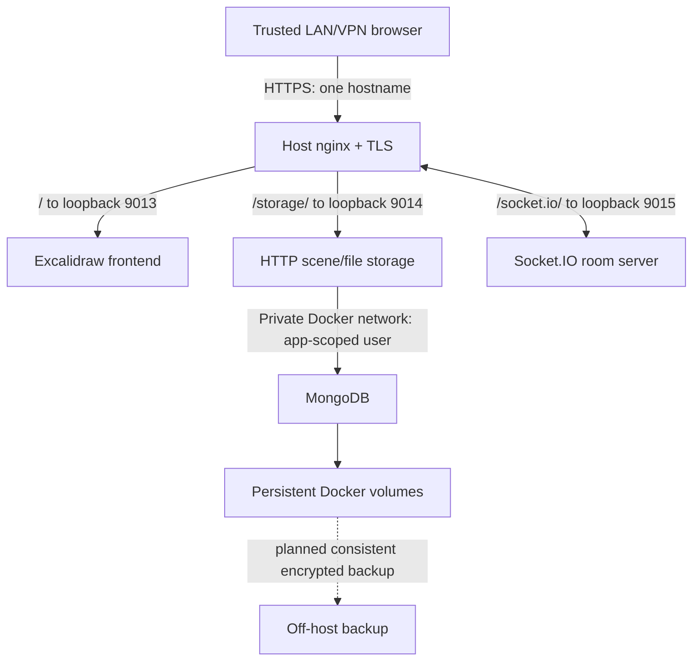

# Excalidraw: collaboration and persistent scene storage

## Position

Adopt **Excalidraw + alswl/excalidraw-collaboration + Docker Compose + host nginx**
as a proposed, separate infra-owned service. The deployment scaffold is in
[systems/excalidraw](../../systems/excalidraw/README.md). This is unscheduled work,
not an addition to the home-automation stack or an authorization to deploy.

The normal self-hosted frontend primarily keeps its working canvas in browser
storage. This project explicitly configures an HTTP storage backend with MongoDB;
it must not silently run the backend's default in-memory store.

## Architecture

Frontend URLs use the public HTTPS origin, **not Docker service names**. nginx
strips `/storage/` so `/storage/api/v2/scenes/…` reaches `/api/v2/scenes/…`.
Socket.IO retains `/socket.io/` and supports HTTP polling and WebSocket upgrades.
The room server is not the durable store; MongoDB holds scenes, rooms and files
through the HTTP backend.

## Upstream baseline

Reviewed upstream collaboration commit
[`267440c4a36eccbcff159528064eefbbfa3e717b`](https://github.com/alswl/excalidraw-collaboration/tree/267440c4a36eccbcff159528064eefbbfa3e717b)
on 2026-11-07, including its basic and advanced-nginx examples. The environment
example records the upstream release tags for frontend, storage, room and MongoDB.
These are reproducibility starting points, not evidence of current security support.
Production commissioning must assess vulnerabilities and pin reviewed digests.

Storage source reviewed at
[`8e64f108b6c18bc3e7ddb7404199cf1a0ba8e602`](https://github.com/alswl/excalidraw-storage-backend/tree/8e64f108b6c18bc3e7ddb7404199cf1a0ba8e602):
`STORAGE_URI` selects the Keyv adapter, an omitted URI uses non-persistent memory,
and the default API prefix is `/api/v2`. Source review is not a runtime test of
the pinned container image.

Local additions to the upstream arrangement: loopback bindings, no Mongo port,
private database network, persistent named volumes, a database-scoped app user,
Mongo readiness dependency and bounded container logs. No SSO is claimed.

## Save and retrieve versus document management

| Requirement | This project |
|---|---|
| Draw in a browser | Frontend; ordinary canvas may remain browser-local |
| Live multi-browser editing | Room service plus HTTP persisted room state; needs commissioning |
| Save/reopen scene links and image files | HTTP backend backed by MongoDB; keep the full link/key |
| Named files and portable copies | Manual `.excalidraw` export/import |
| Login → drawing list → open → explicit Save | **Not implemented** |
| Folders, ownership, searchable diagrams, revision history | **Not implemented** |
| Named JSON files/history in Forgejo | Separate follow-up decision; no API/token integration yet |

Scene-link exports can be snapshots; they are not automatically a named editable
document. Losing an encrypted link's key/fragment can make the corresponding
stored content unusable. A DB backup alone is therefore not the full user recovery
story. Keep a protected link index and editable exports, never publish private
diagrams or link keys in a public repository.

A future thin document layer could keep named `.excalidraw` JSON files in private
Forgejo repositories, providing file history and retrieval without a new storage
platform. Authentication, token scopes, conflict handling and the editor's Save/Open
workflow need design before implementation. Git diffs of diagram JSON are not a
guarantee of useful visual diffs; libraries/image embedding also need validation.

## Open decisions / deployment gate

- Owning host/VM/LXC, architecture, resource sizing and Docker operational owner.
- Agreed hostname (proposed `draw.keithmarston.me.uk`), DNS, certificate provisioning
  and same-host nginx placement. No Terraform resources are created by this project.
- Trusted LAN/VPN ingress rules or an explicit authenticated reverse proxy design.
  Protect **all three** routes; the application does not supply user accounts.
- Supported image versions/digests and an upgrade/security review cadence.
- Off-host backup destination, schedule, retention, encryption, recovery objectives
  and backup-failure/staleness monitoring. Follow the
  [layered backup evaluation](backup-recovery.md): consider Borg/restic for
  consistent MongoDB dumps and protected exports/links, with PBS guest recovery
  where applicable. A live volume file copy is not an agreed consistency method.
- Whether scene links plus exports suffice or a named Forgejo document layer is needed.

VyOS/split-horizon DNS stays in the Sprint 2 network boundary. Do not open public
firewall ports as a shortcut for browser testing.

## Acceptance checklist (not yet completed)

- [ ] Compose validates with protected runtime configuration; images pull on the host.
- [ ] Mongo becomes healthy; storage uses the persistent URI with no connection errors.
- [ ] Port inventory confirms loopback-only app listeners and no public Mongo listener.
- [ ] Trusted HTTPS works; nginx syntax and certificate trust are valid.
- [ ] Browser network requests use this origin, `/storage/api/v2` and `/socket.io`.
- [ ] Two independent browser profiles join one room and see edits in both directions.
- [ ] A scene containing an embedded image is exported as a link and reopened in a
  second browser without relying on the first browser's local storage.
- [ ] Room and exported scene workflows are independently tested after all service
  restarts and after ordinary Compose down/up, retaining full links/keys.
- [ ] An exported `.excalidraw` file imports with editable elements and embedded images.
- [ ] Oversized uploads fail understandably; actual backend limits are checked rather
  than inferred from nginx's 40 MB request limit.
- [ ] Unauthorized/out-of-scope clients cannot reach frontend, storage or room routes.
- [ ] A consistent encrypted off-host backup restores in isolation, including working
  old links/keys/images; recovery evidence and monitoring are recorded.
- [ ] Host inventory, deployed digests, rollback instructions and live status are updated.