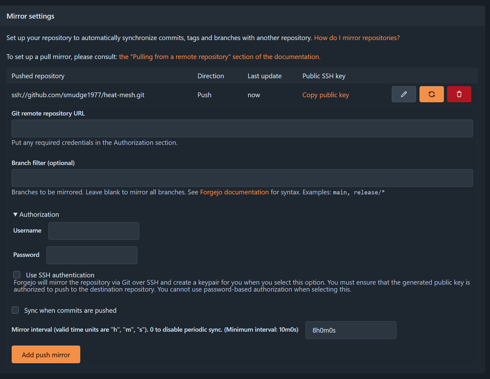

# Home (Forgejo)[https://forgejo.org/]
(https://forgejo.org/)[https://forgejo.org/]

## Objective

Have a local Forgejo instance that dose CI/CD and package registeries
Backup the source to Github/GitLab public 

## Layout

```text
proxmox

├─ forgejo01
│   ├─ forgejo
│   ├─ postgres
│   └─ registry
│
├─ runner01
│   ├─ docker
│   └─ forgejo runner
│
└─ backup01
    └─ restic repo

GitHub
└─ public mirror
```

Well at the moment 

```text
prox04
├─ forgejo - Community LXC
│   ├─ forgejo
│   ├─ SQLite
│   └─ registry
```


## Add the push to Github


Besure to open the authoirize spinner and tick ssh to then get a link for the public key
this public key becomes a write deploy key in the Github repo

