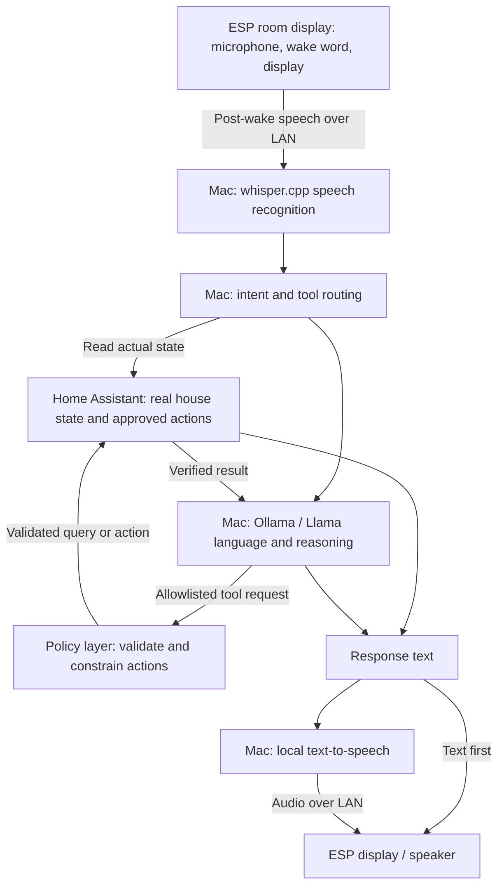

# Idea: local voice assistant for home infrastructure

**Status:** proposed, unscheduled infrastructure idea. No sprint or Forgejo issue
assigned; nothing deployed or commissioned by this document.

## Summary

Explore reusing one or more existing ESP-based room displays as **local voice
endpoints**, making use of their microphone/speaker hardware where fitted and
supported. Keep the ESP deliberately thin: audio capture, local wake-word
detection if supported, display feedback and eventually audio playback. Run
speech recognition, intent/tool routing, language models and speech synthesis
centrally on the Mac.

This is a home infrastructure capability, not a replacement heating controller.
infra-home owns the Mac services, networking, access policy and recovery;
HeatMesh continues to own room-display firmware and heating behaviour. Follow
the existing [Home Assistant ownership boundary](homeassistant.md).

## Target architecture



**ESP = ears/mouth/display; Home Assistant = truth and control; Mac = compute;
Whisper = hearing; Llama = reasoning/language.** Keep these replaceable and
independently testable. A house-state query need not involve the LLM at all.

## Hardware reuse: prove before committing

The existing HeatMesh room-display configuration declares an ESP32-C6 target
with an LVGL display and touchscreen. That alone does **not** establish working
microphone/speaker support, adequate memory or compatibility with
`micro_wake_word`. Do not assume an ESP32-S3 voice example works on the C6.

Inventory the actual boards, revisions and fitted audio parts. Prefer reusing
their built-in microphone/speaker if available; check schematics, codec drivers,
pin conflicts, RAM/PSRAM and support in the selected ESPHome version. If a board
cannot run local wake-word detection alongside its display reliably, evaluate a
voice-capable ESP endpoint (for example a suitable ESP32-S3 board) while retaining
the existing display's room-control role. Do not silently substitute continuous
room-audio streaming to the Mac.

## Staged implementation

### Stage 0 — Prove the hardware

- Identify each candidate ESP variant, board revision, flash and RAM/PSRAM.
- Identify the microphone interface: I²S, PDM or analogue; confirm capture in
  ESPHome and any required codec configuration.
- Confirm whether a speaker/amplifier is fitted and supported, or needs adding.
- Check power, available pins, Wi-Fi behaviour and resource use during capture
  while the existing display, touch and room-stat functions remain active.
- Verify local wake-word support on the actual chip/toolchain before Stage 1.

**Success:** reliably capture intelligible speech without destabilising existing
room display/control functions. Record the hardware go/no-go and fallback choice.

### Stage 1 — Local wake word

Use ESPHome `micro_wake_word` on supported hardware. Start with the existing
English **“Okay Nabu”** model rather than training a custom model:

```yaml
# Illustrative model selection only; not a complete device configuration.
micro_wake_word:
  models:
    - model: okay_nabu
```

Normal room display → local wake detection → visible **LISTENING…** feedback.
Wake detection should not require continuous microphone streaming to the Mac.

**Success:** repeatable recognition with an acceptable measured false-trigger
rate, with display responsiveness and room controls preserved.

### Stage 2 — ESP → Mac speech recognition

After wake detection, send the following utterance over the LAN to a Mac voice
service running **whisper.cpp**. Do not involve Llama yet. Choose and document the
ESPHome audio transport/bridge, sample format, utterance-end detection, timeouts
and return-text path; a working direct ESPHome-to-whisper.cpp connection is not
assumed. Evaluate Home Assistant Assist/Wyoming-compatible plumbing where useful,
without changing the local-compute or source-of-truth boundaries.

Example: “What temperature is the bedroom?” → transcription on the ESP display.
This stage displays the words only; answering from house data comes later.

**Success:** say something → Mac transcribes it → words appear on the room display.

### Stage 3 — Add local Llama

Run **Ollama** on the Mac with a Llama model sized to the actual Mac memory and
latency budget. Route transcription → local model → response text → ESP display.

Example: “Okay Nabu, explain why the sky is blue.” → a short explanation on screen.
No Home Assistant actions are exposed at this stage.

**Success:** a general conversational question produces a sensible local response
on the display, without cloud inference.

### Stage 4 — Home Assistant becomes a read-only tool

For “What's the lounge temperature?”, retrieve the actual mapped Home Assistant
entity state. Never ask Llama to invent it. Supply units, freshness and
availability; report unknown/unavailable data rather than manufacturing a value.

Candidate domains: temperature/humidity, thermostat setpoints, TRV state, boiler
demand, lights, presence, doors/windows, energy use, alarms and device/battery
health. Start with a small explicit read-only entity allowlist; these are possible
domains, not blanket permission to expose every entity.

**Success:** house-state questions are answered from verified Home Assistant data.
Llama may phrase or explain the answer, but Home Assistant remains authoritative.

### Stage 5 — Text-to-speech

Keep text on the display as the initial response path. Then synthesize response
audio on the Mac and return it to a supported ESP speaker.

Try macOS-native TTS with an installed offline voice if convenient; evaluate
**Piper** for a more explicitly controlled local voice stack. Verify offline
operation, output format, playback support and turn-taking so the endpoint does
not trigger on its own response.

**Success:** a complete hands-free question/answer cycle, with text fallback.

### Stage 6 — House-aware reasoning

Expose selected Home Assistant state as structured context/tools. For “Why is the
boiler running?”, inspect actual boiler and room demands, measured temperatures,
setpoints and, where available, TRV positions, windows and occupancy.

Example answer, **only if supported by current data**: “The boiler is running
because the lounge is calling for heat. It's 18.6 °C against a 20 °C target.”
Distinguish a software demand/relay indication from proof that the burner or
water flow is physically active. Explain missing evidence rather than guessing.

**Success:** explanations cite the relevant current state and preserve existing
heating policy, interlocks and safety behaviour.

### Stage 7 — Controlled actions

Only enable writes after read-only queries are reliable. Start with low-risk
lights (“Turn the kitchen light off”), then approved heating intentions
(“Set the bedroom to 19 degrees”).

Requested intent → independent policy validation → approved Home Assistant
service/script → verify resulting state → truthful confirmation.

- Allowlist entities and operations; validate arguments, units, room mapping and
  permitted temperature bounds independently of model output.
- Route heating intentions through existing HeatMesh/HA control logic, never
  directly to boiler relays or around schedules, boost expiry or safety guards.
- Require explicit confirmation or disallow consequential operations, including
  locks, alarm changes and infrastructure shutdowns. A wake word is not identity
  verification or authorization.
- Use least-privilege credentials and a validating gateway where HA permissions
  alone cannot enforce the desired per-entity/service scope. No unrestricted HA
  service access for the LLM.
- Confirm observed success only; distinguish accepted commands, pending state,
  unavailable devices and failed actions. Do not replay old commands on reconnect.

**Success:** bounded actions are validated and audited, resulting state is checked,
and ambiguous or unsafe requests are refused without changing the house.

### Stage 8 — Custom wake word

Only after the rest works, evaluate a custom microWakeWord model, perhaps
**“Hey House”** or another distinctive phrase. Train/test it for the actual rooms,
speakers and noise conditions; support for custom models is not a ready-made model
for an arbitrary phrase.

**Success:** a custom phrase meets the same recognition/false-trigger criteria
without degrading endpoint stability.

## Operational and privacy gates

- Keep capture/inference/TTS on the local network; document any initial model or
  voice downloads separately from runtime cloud dependencies.
- Provide visible listening/processing/error feedback and a practical microphone
  mute control; avoid retaining raw audio or full transcripts by default.
- Authenticate endpoints and service calls, protect credentials outside Git and
  restrict listeners/firewall rules to the required LAN paths; no public ingress.
- Record the Mac host, chip/memory, service supervision, model versions, resource
  budget and end-to-end latency before choosing a deployment layout. Sleep/reboot
  or LAN loss must produce a clear unavailable response, not break room controls.
- Bound concurrent sessions and utterance length. Test multi-room routing so a
  reply or action confirmation returns to the correct endpoint.
- Preserve existing heating/display operation when voice services fail. Test a
  known-good firmware rollback before flashing a room controller; disable voice
  independently if CPU, memory, audio or network use causes instability.
- Back up service configuration, approved tool mappings and recoverable credentials
  securely; document model/voice retrieval and demonstrate service recovery before
  calling the feature commissioned. Log minimal action/audit metadata with defined
  retention rather than private conversations.

## First milestone

Build exactly this before integrating the complete assistant:

**“Okay Nabu” → ESP detects locally → speak → Mac Whisper → transcription appears
on the ESP display.**

Hardware proof is the prerequisite. No Llama, Home Assistant actions or spoken
response is required for this milestone. Measure reliability, latency and impact
on existing room-display functions before adding the next layer.

## References for implementation evaluation

- [ESPHome microWakeWord](https://new.esphome.io/components/micro_wake_word/)
- [Existing okay_nabu model](https://github.com/esphome/micro-wake-word-models/blob/main/models/v2/okay_nabu.json)
- [whisper.cpp](https://github.com/ggml-org/whisper.cpp)
- [Ollama](https://ollama.com/)
- [Infrastructure backlog](../backlog.md)

These are candidate implementation references, not evidence that the existing
ESP32-C6 displays or a particular integration have passed compatibility testing.