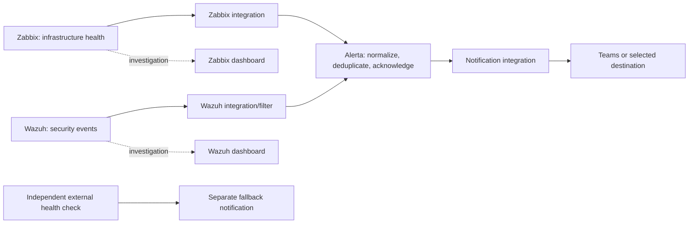

# Monitoring alert aggregation

Status: proposed integration design, 2026-11-08; no live webhook, token, Teams
workflow or alert action is configured. Part of the
[monitoring appliance](monitoring-architecture.md).

## Intended flow

Select supported integrations for the pinned releases. Do not assume either
source has a turnkey Alerta connector or that Alerta directly supports the chosen
Teams endpoint. Use supported webhooks/plugins or a small authenticated adapter
where necessary, and record its ownership, packaging and failure behavior.

For Teams, verify the tenant's currently supported workflow/webhook delivery
method, permissions, payload limits and owner continuity. Do not assume legacy
Incoming Webhook connectors are available or permanent. Secrets stay outside Git.

## Normalized alert contract

| Field | Design rule |
|---|---|
| Environment/resource | Stable environment and host/service identity; avoid display-name-only identity |
| Event | Stable condition/rule name; never use a changing timestamp as the event key |
| Origin | Identify Zabbix or Wazuh and preserve source problem/rule/agent identifiers |
| Severity | Explicit per-source mapping to the chosen Alerta severities; test ordering and clear semantics |
| Status/lifecycle | Distinguish open, acknowledged and recovered/closed; use the supported API semantics |
| Context | Summary, first/last observation, occurrence count and private source investigation link |
| Classification | Service/component and security classification; no secrets or full sensitive log payloads in Teams |

Verify the selected Alerta release's actual deduplication/correlation keys and
configure source/resource/event identities accordingly. Preserve source identity
in the key space so unrelated alerts cannot collide. Do not assume an arbitrary
attribute participates in deduplication simply because it is included in a payload.

## Source lifecycle rules

**Zabbix:** send both problem and recovery events using a stable condition identity,
while retaining the problem ID as context. Repeat updates must not create another
actionable alert. Recovery must match and clear the correct alert; suppress
planned maintenance where policy permits. An Alerta acknowledgement does not
automatically acknowledge a Zabbix problem or resolve the fault.

**Wazuh:** send selected actionable detections, not every raw security event. Many
detections are point-in-time events without a natural recovery signal. Define a
rule-specific policy: manual closure, explicit correlated recovery, or expiry
after a documented quiet period. Expiry means no longer actionable, not proof
that the underlying security condition was fixed. Preserve forensic evidence in
Wazuh; avoid placing full logs or personal data into Alerta/Teams.

Define severity maps separately: Zabbix severities and Wazuh rule levels are not
interchangeable. Route critical security cases deliberately; deduplicate genuine
repeats without merging unrelated incidents or suppressing a severity escalation.

## Notification and resilience policy

- Alerta is the normal notification policy boundary. Notify on initial actionable
  conditions, meaningful escalation and recovery according to explicit routing;
  avoid a Teams message for every repeated observation.
- Define acknowledgement ownership, maintenance suppression, repeat/escalation
  intervals and closure responsibility. Teams messages are not automatically
  a two-way acknowledgement interface.
- Specify bounded retries/backoff, timeouts and rate-limit handling. If adapters
  are needed, decide durable queue/spool behavior, capacity and overflow reporting;
  do not claim guaranteed delivery without implementing and testing it.
- Retain failed delivery evidence without logging secrets; replay with stable
  identities to avoid duplicates. Bound stale replay and handle out-of-order
  problem/recovery events so delayed problems do not reopen resolved conditions.
- Monitor ingestion lag, integration failures, queue depth and notification health.
  Exercise the pipeline with a synthetic alert and matching recovery.
- The appliance cannot reliably report its own total outage. Keep an independent
  external heartbeat/check and separately routed fallback alert for appliance or
  Alerta failure. Choose its host/destination before acceptance; it must not depend
  on the same LXC, PostgreSQL engine or Alerta notification path.
- Retain source history during integration downtime. Any emergency direct source
  notification is an explicitly gated fallback, not a second permanent routine feed.

## Acceptance tests

- [ ] A synthetic Zabbix problem produces one Alerta alert and the expected message.
- [ ] Repeats update that alert; escalation and recovery behave as documented.
- [ ] Acknowledgement behavior is explicit and does not falsely mark a fault recovered.
- [ ] Selected Wazuh detections route correctly; repeated detections, unrelated events
  and no-recovery closure/expiry policies behave as intended.
- [ ] Maintenance and low-priority filtering suppress noise without dropping critical cases.
- [ ] Alerta/destination outages and rate limits exercise retries, bounded storage and
  failure reporting; replay/out-of-order events do not cause duplicate or stale alerts.
- [ ] Messages contain useful private investigation links and no credentials or
  unnecessary sensitive log content.
- [ ] An independent check detects total appliance/Alerta failure through its fallback path.
- [ ] An isolated restore test cannot notify real recipients or reconnect production agents.